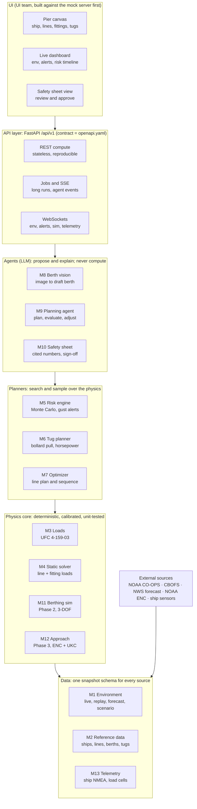

# Mooring Assistant: Modeling Plan & API Spec

Nov 4, 2026 · Mike Snyder · FLEETHACKER Norfolk 2026

> Exported from the live planning doc: https://claude.ai/artifact/AqsZKe2xtYVV8HHBs2SSak. That doc stays the place for comments; re-export here when it changes.

## Summary

We build the modeling layer as a Python service with a published REST/WebSocket contract, so the UI team and each modeler can build in parallel from day one. It covers three evolutions in order: **moored** (Phase 1), **berthing** (Phase 2) and **approach** (Phase 3). They share one data model, one environmental-load engine and one NSTM 582 rule checker.

The design rests on three choices:

- **Deterministic physics, stochastic inputs.** Forces and line loads come from published Navy methods (UFC 4-159-03 and NSTM 582), so every number on the safety sheet can be audited. Uncertainty from gusts, current and tide is handled by Monte Carlo over input distributions fitted to NOAA history.
- **Agents plan, tools compute.** LLM agents choose line layouts and tug positions, read berth maps and write the rationale. Every number they cite comes from a physics tool call, never from the model.
- **Contract first.** We publish `openapi.yaml` and a mock server before any physics exists. The UI builds against the mock, and modules replace mock responses as they land.

## Phases and scope

Phase 1 alone covers every hackathon deliverable: the canvas inputs, the physics-informed agent, tug horsepower, the line sequence, gust warnings and the approved Mooring Evolution Safety Sheet. Phases 2 and 3 add time-domain dynamics on the same contracts.

| Phase | Evolution | Question it answers | Model type | Key outputs |
| --- | --- | --- | --- | --- |
| 0 | Foundations | Can everyone build against stable contracts? | None | `openapi.yaml`, mock server, shared schemas, seed data (ships, lines, berths, tugs), NOAA replay feed |
| 1 | **Moored** | Is this line plan safe for the forecast, and when does it stop being safe? | Quasi-static 3-DOF equilibrium plus Monte Carlo | Line and fitting loads, NSTM compliance, gust exceedance risk, limiting-wind envelope, tide tending schedule, holding tugs, recommended configuration, line sequence, safety sheet |
| 1b | Berth map analysis | What fittings does this berth have and where should lines go? | Vision LLM plus ENC geometry | Draft berth model for human confirmation, recommended line placement |
| 1c | Berthing (static) | How much tug power do we need to land and hold the ship? | Static force balance | Required bollard pull and horsepower, tug count and push points, berthing window from current predictions |
| 2 | **Berthing** (dynamic) | What happens from 1–2 ship lengths off until all lines are fast? | 3-DOF time-domain simulation | Lateral speed at contact, fender energy, line snatch loads, interactive tug control, sequence timing |
| 3 | **Approach** | Can we transit the channel to the berth safely at this time? | Maneuvering model on ENC geometry | Predicted track, under-keel clearance with tide and squat, current set along route, tug rendezvous and abort points |

Out of scope for now: waves and swell (sheltered harbor), nested moorings beyond a warning flag, anchoring, and Med moors.

## Architecture

The service is a layered Python package behind one FastAPI app. Each layer calls only the layers below it, so the physics core never depends on an LLM.



The UI talks only to the API layer. The agents reach the planners and physics through the same endpoints the UI uses, which keeps one tested code path.

**Tech stack:**

- **Service:** Python 3.12, FastAPI, Pydantic v2 for schemas and OpenAPI generation.
- **Computation:** NumPy and SciPy for the solver and Monte Carlo.
- **Data access:** httpx for NOAA, xarray and netCDF4 for CBOFS, GDAL and Fiona for ENC charts (Phase 3).
- **Agents:** Anthropic SDK with tool use; HTML-to-PDF rendering for the safety sheet.
- **Storage:** YAML catalogs in the repo; SQLite for scenarios, results and sheets.
- **Jobs:** an in-process async worker for the hackathon, replaceable by a queue later.

**Repo layout.** The `mooring/` package is pure Python with no web imports. `api/` is a thin HTTP layer over it.

```text
mooring/
  core/       schemas.py  units.py  frames.py  envelope.py
  refdata/    ships/*.yaml  lines.yaml  berths/*.yaml  tugs.yaml
  env/        noaa.py  replay.py  forecast.py  scenario.py  gust_model.py  telemetry.py
  loads/      ufc_wind.py  ufc_current.py
  solver/     static.py  line_models.py  fenders.py  envelope.py  tide_sweep.py
  rules/      nstm582.py
  risk/       monte_carlo.py  timeline.py  alerts.py
  tugs/       planner.py  windows.py
  planning/   optimizer.py  sequence.py  sequence_rules.yaml
  vision/     berth_extract.py  enc.py
  agent/      orchestrator.py  tools.py  prompts/
  sheet/      safety_sheet.py  templates/
  dynamics/   berthing.py  approach.py  squat.py
api/          main.py  routers/  jobs.py  ws.py
tests/        golden/  contract/  agent_evals/
openapi.yaml
```

## API conventions

Every field name carries its unit, in the units a bridge team uses. The physics runs in SI internally and converts at the API edge.

| Quantity | API unit | Field suffix | Example |
| --- | --- | --- | --- |
| Speed (wind, current, ship) | knots | `_kt` | `wind_speed_kt` |
| Length, depth, draft, water level | feet | `_ft` | `water_depth_ft` |
| Force, tension, capacity | pounds-force | `_lbf` | `tension_lbf` |
| Yaw moment | foot-pounds | `_ftlbf` | `yaw_moment_ftlbf` |
| Displacement | long tons | `_lt` | `displacement_lt` |
| Power | horsepower | `_hp` | `tug_power_hp` |
| Angles and bearings | degrees | `_deg` | `heading_true_deg` |
| Line size | circumference, inches | `_circ_in` | `size_circ_in` |
| Time | ISO 8601 UTC | `_utc` | `valid_at_utc` |

**Direction conventions** (the most likely source of bugs):

- **Wind** uses the meteorological convention: direction the wind blows *from*, degrees true. This matches NOAA wind data.
- **Current** uses the oceanographic convention: direction the water flows *toward* (set), degrees true. This matches NOAA `currents` data, where flood at cb0402 is about 190°.
- Each environment object also returns `wind_rel_ship_deg` and `current_rel_ship_deg`, the relative bearing on the ship (0 = bow, 90 = starboard beam). That bearing is the input UFC 4-159-03 uses.

**Coordinate frames:**

- **Berth frame:** origin at the berth reference point on the pier face. +x runs along the face toward the outer end of the pier, +y runs off the face into the water, and +z is up from MLLW. Pier fittings, fenders and camels live in this frame.
- **Ship frame:** origin at midships on the centerline at the waterline. +x is forward, +y is to port, +z is up. Ship fittings, chocks and tug push points live in this frame.
- **Geo:** WGS84 latitude/longitude, used for berths, environment stations and approach tracks. Each berth stores the true bearing of its face line, which links the berth frame to geo.

**Response envelope.** Every compute endpoint returns the same wrapper so the safety sheet can trace each number:

```json
{
  "result_id": "res_01J...",
  "model": "mooring.solver.static",
  "model_version": "1.2.0",
  "inputs_hash": "sha256:...",
  "computed_at_utc": "2026-11-04T15:48:00Z",
  "status": "GREEN | AMBER | RED",
  "assumptions": ["Wet nylon strength reduced 15% (NSTM 582-2.4.2.i)"],
  "warnings": [{"rule_id": "NSTM-LEAD-45", "severity": "AMBER", "message": "..."}],
  "result": { }
}
```

**Other rules:**

- Base path `/api/v1`. Breaking changes require `/api/v2`.
- Compute endpoints are **stateless**: the request carries every input, so a result can be reproduced from `inputs_hash`. Each also accepts a `scenario_id` shortcut that fills inputs from a saved scenario.
- Anything slower than about 2 seconds (Monte Carlo, optimizer, agents, simulations) is an **async job**. `POST` returns `202 {job_id}`, `GET /jobs/{job_id}` returns status and result, and `GET /jobs/{job_id}/events` streams progress as Server-Sent Events.
- Live data uses WebSockets: `/ws/env`, `/ws/alerts`, `/ws/sim/{session_id}`.
- Validation errors return `422` with field paths. Domain failures, such as no feasible configuration, return `200` with `status: RED` and a findings list, because the UI should show them, not treat them as crashes.

## Shared data model

Every module uses these schemas. They are written below as TypeScript for the UI team. The source of truth will be Pydantic models in `mooring/core/schemas.py`, and both `openapi.yaml` and the TypeScript client are generated from them.

```typescript
// ---------- Reference data ----------
interface ShipClass {
  class_id: string;                 // "DDG-51-FIII"
  name: string;
  loa_ft: number; lwl_ft: number; beam_ft: number;
  loading_conditions: LoadingCondition[];   // e.g. full load, light
  wind_area_lateral_ft2: number;     // side profile above waterline
  wind_area_frontal_ft2: number;
  hull_wind_area_lateral_ft2: number; // UFC splits hull vs superstructure
  wind_drag_class: "hull_dominated" | "typical" | "extensive_superstructure"; // UFC Table 4-2
  fittings: ShipFitting[];           // bitts and chocks
  push_points: PushPoint[];          // hull positions marked for tugs
  standard_line_outfit: LineInventoryItem[];
  mst_class: "II" | "IIA";          // CVN 68, LHA 1, LHD 1/5 are IIA
  provenance: Provenance;            // public source or "estimated"
}
interface LoadingCondition { name: string; displacement_lt: number; draft_fwd_ft: number; draft_aft_ft: number; freeboard_ft: number; }
interface ShipFitting {
  fitting_id: string; kind: "bitt" | "chock" | "cleat" | "recessed_bitt";
  x_ft: number; y_ft: number; z_ft: number;   // ship frame
  side: "port" | "starboard" | "centerline";
  swl_lbf?: number; max_rope_circ_in?: number; // NSTM Tables 582-5-3/4
  paired_chock_id?: string;                    // bitt -> chock the line leads through
}
interface PushPoint { push_point_id: string; x_ft: number; side: string; max_force_lbf: number; }

interface LineSpec {
  spec_id: string;                  // "NYLON-DB-8IN"
  material: "nylon" | "polyester" | "aramid" | "uhmwpe" | "wire";
  construction: "three_strand" | "plaited" | "double_braid" | "twelve_strand" | "four_strand" | "wire";
  size_circ_in: number;
  mbs_lbf: number;                  // minimum breaking strength, dry
  load_elongation: [number, number][]; // [fraction of MBS, strain] curve
  wet_strength_factor: number;      // 0.85 for nylon
  provenance: Provenance;
}

interface Berth {
  berth_id: string;                 // "NAVSTA-NORFOLK-P12-N"
  name: string;
  face_bearing_true_deg: number;    // links berth frame to geo
  origin_lat: number; origin_lon: number;
  face_length_ft: number;
  deck_height_mllw_ft: number;
  depth_profile: { x_ft: number; depth_mllw_ft: number }[];
  fittings: PierFitting[];
  fenders: Fender[];               // camels, separators, fenders
  structure: "open_pile" | "solid"; // solid quay walls block current in slips
  env_station_ids: { wind: string; current: string; water_level: string };
  provenance: Provenance;           // "mock" | "ENC" | "vision_confirmed" | ...
}
interface PierFitting {
  fitting_id: string;
  kind: "bollard_special_a" | "bollard_special_b" | "bollard_horn" | "double_bitt_lip" | "low_double_bitt" | "cleat_42" | "cleat_30";
  x_ft: number; y_ft: number;       // berth frame
  capacity_horizontal_lbf: number; capacity_45deg_lbf?: number; // NSTM Table 582-5-6
  condition: "good" | "suspect" | "do_not_use";
  occupied_by?: string;             // another ship's line
}
interface Fender { fender_id: string; kind: "camel" | "pneumatic" | "foam" | "separator"; x_ft: number; standoff_ft: number; stiffness_lbf_per_ft: number; rated_energy_ftlbf: number; }

interface TugSpec { tug_id: string; name: string; propulsion: "conventional" | "asd" | "tractor" | "vsp"; power_hp: number; bollard_pull_ahead_lbf: number; bollard_pull_astern_lbf: number; }

// ---------- Plans ----------
interface MooringLine {
  line_number: number;              // numbered forward to aft (NSTM 582-4.2.1)
  role?: "bow" | "breast" | "spring_fwd" | "spring_aft" | "stern"; // computed if omitted
  spec_id: string;
  parts: 1 | 2 | 3;                 // single, tanker (2), doubled up (3)
  ship_fitting_id: string; chock_id?: string;
  pier_fitting_id: string;
  pretension_lbf?: number;          // or slack_ft
  slack_ft?: number;
}
interface MooringConfig { config_id?: string; side_to: "port" | "starboard"; ship_x_ft: number; lines: MooringLine[]; }
interface TugAssignment { tug_id: string; push_point_id: string; mode: "push" | "pull" | "standby"; force_lbf: number; direction_true_deg: number; }

// ---------- Environment ----------
interface EnvironmentSnapshot {
  valid_at_utc: string;
  source: "live" | "replay" | "forecast" | "scenario" | "ship_sensor";
  wind_speed_kt: number;            // sustained, 10 m height, 1-min average (normalized)
  wind_gust_kt: number;
  wind_from_true_deg: number;
  current_speed_kt: number;
  current_set_true_deg: number;
  water_level_mllw_ft: number;
  tide_stage?: "flood" | "ebb" | "slack";
  air_density_kgm3?: number; water_density_kgm3?: number; // brackish default 1020
  quality: { station_id: string; age_s: number; flags: string[] }[];
}

// ---------- Common ----------
interface Provenance { source: string; url?: string; confidence: "published" | "estimated" | "mock" | "vision"; notes?: string; }
interface Finding { rule_id: string; severity: "INFO" | "AMBER" | "RED"; element_ids: string[]; message: string; reference: string; }
```

## Modules and API contracts

There are 13 modules. Each owns its endpoints and a pure-Python function behind them, so a modeler can test without HTTP and the UI can call the same thing over HTTP.

| # | Module | Phase | Endpoints (under `/api/v1`) | Sync or job |
| --- | --- | --- | --- | --- |
| M1 | Environment service | 0–1 | `GET /env/now`, `GET /env/forecast`, `GET /env/history`, `POST /env/scenarios`, `GET /env/gust-model`, `WS /ws/env` | sync, stream |
| M2 | Reference data | 0 | `GET/POST /ships`, `/lines`, `/berths`, `/tugs`; `GET/POST /scenarios` | sync |
| M3 | Environmental loads | 1 | `POST /loads/environmental`, `POST /loads/polar` | sync |
| M4 | Static mooring solver and compliance | 1 | `POST /mooring/analyze`, `POST /mooring/envelope`, `POST /mooring/tide-sweep`, `GET /rules` | sync |
| M5 | Risk engine | 1 | `POST /risk/exceedance`, `POST /risk/timeline`, `WS /ws/alerts` | job, stream |
| M6 | Tug planner | 1, 1c | `POST /tugs/hold-plan`, `POST /tugs/berthing-plan`, `POST /windows/berthing` | sync |
| M7 | Configuration optimizer and sequence | 1 | `POST /mooring/recommend`, `POST /mooring/sequence` | job, sync |
| M8 | Berth map analysis agent | 1b | `POST /berth-vision/analyze`, `POST /berth-vision/{id}/confirm` | job |
| M9 | Mooring planning agent | 1 | `POST /agent/plans`, `GET /agent/plans/{id}`, `POST /agent/plans/{id}/messages` | job, SSE |
| M10 | Safety sheet and approvals | 1 | `POST /safety-sheets`, `GET /safety-sheets/{id}`, `GET /safety-sheets/{id}/render`, `POST /safety-sheets/{id}/approvals` | sync |
| M11 | Berthing simulator | 2 | `POST /berthing/simulate`, `POST /berthing/sessions`, `WS /ws/sim/{session_id}` | job, stream |
| M12 | Approach planner and simulator | 3 | `POST /approach/route`, `POST /approach/simulate`, `POST /approach/ukc` | job |
| M13 | Telemetry ingest | deploy | `WS /ws/telemetry`, `POST /telemetry/batch` | stream |

Cross-cutting: `GET /jobs/{id}`, `GET /jobs/{id}/events` (SSE), `GET /health`, `GET /version`.

### M1 Environment service

This module normalizes every source (live NOAA, historical replay, forecast, synthetic scenario, and later the ship's own sensors) into `EnvironmentSnapshot`. Nothing downstream knows where the data came from.

- **Sources for Norfolk** (confirmed live on 2026-11-04 through the CO-OPS API): wind and gust from `8638614` Willoughby Degaussing Station; current and current predictions from `cb0402` Naval Station Norfolk LB 7; water level and tide predictions from `8638610` Sewells Point. Forecasts come from CBOFS for current and water level, and from NWS gridpoint forecasts for wind.
- **Normalization:** convert NOAA 6-minute wind and the anemometer height to a 10 m, 1-minute sustained wind, which is the basis UFC uses. Record the conversion in `assumptions`.
- **Replay mode** plays a stored historical window at 1× to 60× speed. Demos use this for repeatable "live" storms, for example a nor'easter pulled from history.
- **Gust model:** fit the distribution of gust factor (gust ÷ sustained) and direction scatter from at least 1 year of Willoughby data, binned by wind direction sector. Also fit current residuals (observed minus predicted at cb0402). M5 samples from these.

```http
GET /api/v1/env/now?berth_id=NAVSTA-NORFOLK-P12-N
-> 200 EnvironmentSnapshot (+ wind_rel_ship_deg, current_rel_ship_deg when ?heading_true_deg= is given)

GET /api/v1/env/forecast?berth_id=...&hours=48&step_min=30
-> 200 { series: EnvironmentSnapshot[] }

POST /api/v1/env/scenarios
{ "name": "MST II design", "kind": "steady", "wind_speed_kt": 64, "wind_gust_kt": 64,
  "wind_from_true_deg": 270, "current_speed_kt": 2.0, "current_set_true_deg": 90, "water_level_mllw_ft": 0 }
  // kind also accepts "ramp" (gust front) and "replay" with start/end UTC
-> 201 { scenario_id }

GET /api/v1/env/gust-model?station=8638614
-> 200 { sectors: [{ from_deg, to_deg, gust_factor: {dist, params}, dir_sigma_deg }], fitted_on: {start_utc, end_utc, n} }

WS /ws/env?berth_id=...&mode=live|replay&scenario_id=&speed=10
-> messages: EnvironmentSnapshot every update
```

### M2 Reference data

This module holds read-mostly catalogs stored as YAML in the repo. The berth `POST` accepts canvas-built or vision-confirmed berths.

- **Ships for Phase 1:** DDG 51, CG 47, LHD 1 and CVN 68. All four appear in NSTM Table 582-3-1, so their wind loads can be calibrated. Dimensions come from public fact sheets; wind areas and fitting positions are estimated and marked as such.
- **Lines:** nylon double braid, polyester double braid and 4-strand aramid, sized 5 to 12 inch circumference. Breaking strength and stretch curves come from manufacturer data sheets.
- **Berths:** 2–3 mock NAVSTA Norfolk piers, both faces of each. Depths are approximate, and fittings use the types and ratings in NSTM Table 582-5-6.
- **Tugs:** a mock harbor fleet of 3–4 tugs, ranging from 3,000 hp conventional to 5,000 hp ASD.
- **Scenarios** bundle ship, loading condition, berth, side-to, environment source and config. They are the UI's save files.

```http
GET /api/v1/ships                 -> [{ class_id, name, loa_ft, ... summary }]
GET /api/v1/ships/{class_id}      -> ShipClass
GET /api/v1/lines                 -> LineSpec[]
GET /api/v1/berths                -> [{ berth_id, name, face_length_ft, depth summary }]
GET /api/v1/berths/{berth_id}     -> Berth
POST /api/v1/berths               Berth -> 201 { berth_id }     // from canvas or M8
GET /api/v1/tugs                  -> TugSpec[]
POST /api/v1/scenarios            { ship_class_id, loading, berth_id, side_to, env_source, config? } -> 201 { scenario_id }
```

### M3 Environmental loads

This module computes the wind and current forces and the yaw moment on the ship, using UFC 4-159-03 Chapter 4.

- **Wind:** transverse force Fyw = ½ · ρa · Vw² · Ay · Cyw · fyw(θw), plus the longitudinal force and yaw moment in the same form. Cyw comes from hull and superstructure areas, with the class factor from UFC Table 4-2.
- **Current:** transverse force Fyc = ½ · ρw · Vc² · Lwl · T · Cyc · sin θc. Cyc depends on the ratio of water depth to draft (Seelig 1992), and this is where berth depth and tide enter. The longitudinal force combines form drag, skin friction and propeller drag.
- **Calibration:** tune each class's wind areas until the 50, 70, 100 and 150 kt loads match NSTM Table 582-3-1 within 10%.
- **Shielding:** an optional `shielding_factor` per berth sector covers pier buildings and adjacent ships. The default is 1.0.

```http
POST /api/v1/loads/environmental
{ "ship_class_id": "DDG-51-FIII", "loading": "full_load", "heading_true_deg": 37.0,
  "water_depth_ft": 45.0, "environment": EnvironmentSnapshot, "use_gust": true }
-> 200 envelope.result = {
  "wind":    { "fx_lbf": -8200,  "fy_lbf": 98000,  "mz_ftlbf": 1.9e6, "coefficients": {...} },
  "current": { "fx_lbf": 1500,   "fy_lbf": 61000,  "mz_ftlbf": -4.0e5, "cyc": 2.1, "depth_draft_ratio": 1.43 },
  "total":   { "fx_lbf": -6700,  "fy_lbf": 159000, "mz_ftlbf": 1.5e6 },
  "off_pier_component_lbf": 159000 }

POST /api/v1/loads/polar      // same inputs, wind and current speeds fixed
-> 200 result = { points: [{ rel_deg, fx_lbf, fy_lbf, mz_ftlbf }] }  // 0-355 by 5, for the UI rose chart
```

(The numbers in examples are illustrative only.)

### M4 Static mooring solver and compliance

This module finds where the ship settles under the environmental load, then computes the load in every line, fitting and fender and checks each against NSTM 582.

- **Unknowns:** surge, sway and yaw offset (x, y, ψ) from the initial position. Heave and roll are ignored in Phase 1.
- **Lines:** each line's length runs from the ship fitting, through its chock, to the pier fitting in 3D. Freeboard, tide and pier deck height set the vertical angle. Tension follows the material's stretch curve times the number of parts. Lines carry tension only, with a smooth cutoff when slack. Unstretched length is set from the pretension or slack the user enters at tie-up.
- **Fenders and camels:** springs that resist compression only. Tug forces from M6 are applied at their push points.
- **Solver:** `scipy.optimize.least_squares` on the force and moment balance, warm-started from the last solution. Target under 50 ms per solve, so M5 can run thousands of samples.
- **Checks:** every rule in the NSTM rule registry section below runs on every solve.
- **Envelope:** for each relative wind direction, bisect on wind speed until the first element reaches its working limit. This answers "what wind breaks this plan?"
- **Tide sweep:** step the water level through the forecast and solve each step. Output a tending schedule, for example "slack line 3 by 1.2 ft before 14:00".

```http
POST /api/v1/mooring/analyze
{ "ship_class_id": "DDG-51-FIII", "loading": "full_load", "berth_id": "NAVSTA-NORFOLK-P12-N",
  "config": MooringConfig, "environment": EnvironmentSnapshot,
  "tugs": TugAssignment[], "mst": "II", "lines_wet": true }
-> 200 envelope.result = {
  "offset": { "surge_ft": 0.4, "sway_ft": 0.9, "yaw_deg": 0.3 },
  "lines": [{ "line_number": 1, "role": "bow", "tension_lbf": 41000, "pct_mbs": 22.0, "pct_wll": 66.0,
             "horiz_angle_deg": 38.0, "vert_angle_deg": 9.0, "breast_efficiency": 0.79, "length_ft": 132.0, "status": "GREEN" }],
  "pier_fittings": [{ "fitting_id": "B12", "load_lbf": 82000, "capacity_lbf": 200000, "pct": 41.0, "lines": [1] }],
  "ship_fittings": [{ "fitting_id": "BITT-1P", "load_lbf": 82000, "swl_lbf": 245000, "pct": 33.0 }],
  "fenders": [{ "fender_id": "CAMEL-2", "reaction_lbf": 0, "compression_ft": 0 }],
  "min_margin": { "element_id": "line-2", "pct_wll": 88.0 },
  "findings": Finding[] }

POST /api/v1/mooring/envelope   // same inputs minus environment wind speed
-> 200 result = { points: [{ wind_rel_deg, limit_wind_kt, first_failure_element, failure_mode: "WLL" | "MBS" | "fitting" }] }

POST /api/v1/mooring/tide-sweep  { ...analyze inputs, "from_utc", "to_utc", "step_min": 30 }
-> 200 result = { steps: [{ valid_at_utc, water_level_mllw_ft, lines: [{ line_number, tension_lbf }] }],
                  tending: [{ at_utc, line_number, action: "slack" | "heave", amount_ft }] }

GET /api/v1/rules -> [{ rule_id, title, severity, reference, applies_to }]
```

### M5 Risk engine

This module turns a single analysis into a probability: how likely the plan is to exceed its limits over a time horizon.

- **Monte Carlo:** draw N samples (default 2,000) of gust factor, wind direction scatter and current residual from the M1 models. Run M4 on each sample. Report, for each element, the probability of exceeding its working limit and its breaking strength.
- **Timeline:** run the exceedance analysis at each forecast step (default 30 minutes over 48 hours). Return a status per step and the first time the plan goes AMBER or RED.
- **Alerts:** in live mode, re-run on each new environment snapshot and push to `/ws/alerts` when status changes or gusts approach the envelope. Example: "Gust 41 kt at 15:42: line 2 at 94% of working limit. Limit wind for this direction is 46 kt."
- **Dynamic factor:** Phase 1 applies a configurable gust dynamic amplification factor (default 1.0, with a sensitivity case at 1.2) and states it in `assumptions`. Phase 2 can replace it with time-domain results from M11.

```http
POST /api/v1/risk/exceedance   { ...analyze inputs, "horizon_hours": 6, "n_samples": 2000, "seed": 42 }
-> 202 { job_id }  ->  result = {
  "p_any_exceeds_wll": 0.07, "p_any_exceeds_mbs": 0.002,
  "elements": [{ "element_id": "line-2", "p_exceed_wll": 0.06, "tension_p50_lbf": 52000, "tension_p95_lbf": 71000 }],
  "governing_element": "line-2" }

POST /api/v1/risk/timeline     { ...analyze inputs, "forecast_hours": 48, "step_min": 30 }
-> 202 { job_id }  ->  result = { steps: [{ valid_at_utc, status, p_any_exceeds_wll, governing_element }],
                                 first_amber_utc, first_red_utc, recommended_actions: ["double up line 2 before 18:00"] }

WS /ws/alerts?scenario_id=...
-> { alert_id, at_utc, severity, element_id, message, env: EnvironmentSnapshot, limit_wind_kt }
```

### M6 Tug planner

This module sizes tugs from force balance. No open-source tool does this, so it is built from published practice.

- **Required force** is the environmental load the lines cannot carry, or the whole load when no lines are fast yet. Use the gust wind, not the mean, and add a 25% margin (Pilot's Tug Assist Tool practice). Both are configurable.
- **Placement:** split the force between the forward and aft push points so that F1 + F2 = Fy and F1·x1 + F2·x2 = Mz. If the result calls for a pull, the tug must be made up with a line, not pushing.
- **Sizing:** use a tug's certified bollard pull when the fleet catalog has it. Otherwise convert horsepower at a configurable rate: about 1.0 short ton per 100 hp for conventional tugs and about 1.25 for ASD or tractor tugs. The output always reports both bollard pull and horsepower.
- **Berthing windows:** scan current predictions at cb0402 and the wind forecast for periods where current is below a threshold (default 0.5 kt) and gusts are below the plan's limit. Rank by required tug power.

```http
POST /api/v1/tugs/berthing-plan
{ "ship_class_id": "DDG-51-FIII", "loading": "full_load", "berth_id": "...", "side_to": "starboard",
  "environment": EnvironmentSnapshot, "margin": 0.25, "available_tug_ids": ["T1", "T2", "T3"] }
-> 200 result = {
  "required_lateral_lbf": 210000, "required_by_point": [{ "push_point_id": "PP-FWD-S", "force_lbf": 120000, "mode": "push" }],
  "assignments": TugAssignment[], "total_bollard_pull_lbf": 240000, "total_power_hp": 9600,
  "recommended_tug_count": 2, "feasible": true, "rationale": ["Gust 28 kt off-pier dominates; current 0.4 kt ebb adds 18%"] }

POST /api/v1/tugs/hold-plan     // moored ship, storm assist: same output, sized to the M4 deficit
POST /api/v1/windows/berthing   { berth_id, ship_class_id, from_utc, to_utc, max_current_kt, max_gust_kt }
-> 200 result = { windows: [{ start_utc, end_utc, max_current_kt, max_gust_kt, required_power_hp }] }
```

### M7 Configuration optimizer and line sequence

This module recommends a line plan and the order to run it.

- **Candidates:** for each ship bitt and chock pair, list the pier fittings that are reachable, under 45° for breast lines and not occupied.
- **Search:** greedy construction, then local search (swap a fitting, change parts, add or remove a line). The objective maximizes the minimum margin over the MST design conditions from the worst directions. Ties go to fewer lines and more symmetric leads. Hard constraints come from the rule registry.
- **Sequence:** a rule table encoding NSTM 582-2.4.6 and pilot practice, with conditions on wind onto or off the pier, current fore or aft, and whether tugs are holding. Each step lists the line, action, station, crews needed and trigger. Example: "Do not take lines 2 and 5 to power until tugs ease off." A deck-seamanship expert reviews the rule table before the demo.

```http
POST /api/v1/mooring/recommend
{ "ship_class_id", "loading", "berth_id", "side_to", "design_mst": "II", "forecast_env": EnvironmentSnapshot[],
  "available_lines": [{ "spec_id", "count" }], "locked_lines": MooringLine[], "excluded_fitting_ids": [], "max_candidates": 3 }
-> 202 { job_id } -> result = { candidates: [{ config: MooringConfig, min_margin_pct_wll, limit_wind_kt_worst,
                                              line_count, analysis_result_id, why: string[] }] }

POST /api/v1/mooring/sequence
{ "config": MooringConfig, "tug_plan_result_id": "...", "environment": EnvironmentSnapshot, "line_handling_crews": 6 }
-> 200 result = { steps: [{ step: 1, line_number: 2, action: "pass" | "secure_pier" | "take_to_power" | "double_up" | "tend" | "hold",
                            station: "forecastle", crews: 1, trigger: "bridge orders", caution?: string, reference: "NSTM 582-2.4.6" }],
                  crews_required: 6 }
```

### M8 Berth map analysis agent

This agent turns a picture of a berth into a draft `Berth` and a recommended line placement. A human confirms the draft before anything uses it.

- **Inputs:** a satellite image, nautical chart image, NAVFAC berthing plan, or a photo of a pier sketch. Optional georeferencing (two known points or a scale bar) and an optional `ship_class_id`.
- **Pipeline:**
  1. When the berth is charted, pull the pier outline and depth areas from NOAA ENC vector data. Geometry is deterministic where it can be.
  2. A vision LLM extracts fitting positions, fitting types, camels and obstructions as structured JSON, with a confidence for each item.
  3. Snap the detections to the pier face, then fill unknown capacities from the defaults in NSTM Table 582-5-6, marked `estimated`.
  4. Call M7 for recommended line placement on the draft berth.
- **Output** is a draft with an overlay for the UI: each detected item has a bounding box, type, confidence and `needs_confirmation`. After the user edits and confirms it, the draft becomes a saved `Berth` with provenance `vision_confirmed`.

```http
POST /api/v1/berth-vision/analyze   (multipart: image, metadata JSON)
{ "image_kind": "satellite" | "chart" | "berthing_plan" | "photo", "georef": { "points": [{ "px": [x, y], "lat", "lon" }] } | { "scale_ft_per_px": 0.5 },
  "ship_class_id": "DDG-51-FIII", "side_to": "port" }
-> 202 { job_id } -> result = {
  "draft_berth": Berth, "detections": [{ "item_id", "kind", "bbox_px": [x, y, w, h], "confidence": 0.82, "needs_confirmation": true }],
  "recommended_config": MooringConfig, "questions": ["Is the fitting at x=310 ft a bollard or a cleat?"] }

POST /api/v1/berth-vision/{job_id}/confirm   { "berth": Berth }  -> 201 { berth_id }
```

### M9 Mooring planning agent

This is the agent the problem statement asks for. It runs the plan, evaluate, adjust loop over tools and explains its decisions.

- **Tools** (each one wraps an endpoint above): `get_environment`, `get_forecast`, `get_ship`, `get_berth`, `compute_loads`, `analyze_mooring`, `envelope`, `risk_exceedance`, `recommend_config`, `plan_tugs`, `berthing_windows`, `generate_sequence`, `draft_safety_sheet`.
- **Loop:**
  1. Gather the scenario and forecast.
  2. Start from the M7 baseline.
  3. Analyze it, read the findings, and modify lines, parts or tugs.
  4. Repeat until every element is GREEN with the target margin, or a stop limit is reached (default 8 iterations), then report the plan as infeasible with the options that remain.
  5. Run the risk timeline, then generate the sequence and the safety sheet draft.
- **Guardrails:**
  - Every number in the rationale must cite a `result_id`, and the server rejects drafts with uncited numbers.
  - The agent cannot override a RED finding. It can only propose changes and re-analyze.
  - The final plan goes to humans for approval (M10).
- **Follow-ups** go through `messages`, for example "what if the wind backs to NW at 35 kt?" The agent re-runs tools and returns a diff from the current plan.

```http
POST /api/v1/agent/plans   { "scenario_id": "...", "objective": "moor_for_forecast" | "berthing" | "storm_prep", "target_margin_pct_wll": 80, "constraints": {...} }
-> 202 { plan_id }

GET /api/v1/agent/plans/{plan_id}/events   (SSE)
event: step      data: { "iteration": 2, "thought_summary": "Line 2 governs at 104% WLL; doubling up", "tool": "analyze_mooring", "result_id": "res_..." }
event: proposal  data: { "config": MooringConfig, "status": "AMBER" }
event: done      data: { "plan_id", "status": "GREEN" }

GET /api/v1/agent/plans/{plan_id}
-> { status, config, tug_plan, sequence, analysis_result_id, risk_result_id, rationale: [{ text, cites: [result_id] }],
     assumptions, open_questions, safety_sheet_id }

POST /api/v1/agent/plans/{plan_id}/messages  { "text": "What if wind backs to NW 35 kt?" }  -> 202 (answer streams on /events)
```

### M10 Safety sheet and approvals

This module assembles the Mooring Evolution Safety Sheet from result IDs only and handles sign-off.

- **Sections:**
  - Evolution header: ship, berth, side-to, date and time.
  - Environment: observed, forecast, and the MST classification.
  - Line plan table: number, role, material, parts, ship fitting, pier fitting, tension, percent of working limit.
  - Fitting utilization.
  - Tug plan: count, horsepower, bollard pull, push points.
  - Mooring sequence.
  - **Go/no-go thresholds**, for example "Double up 2 and 5 if sustained wind exceeds 30 kt. Call tugs if gusts exceed 40 kt."
  - Warnings, agent rationale, assumptions and data sources.
  - Approval block for Pilot, First Lieutenant and Commanding Officer.
- **Versioning:** a sheet is immutable once any approval is recorded. Any re-analysis creates a new version.
- **Rendering:** JSON for the UI, plus HTML and PDF for print.

```http
POST /api/v1/safety-sheets   { "plan_id": "..." }  -> 201 { sheet_id, version: 1 }
GET  /api/v1/safety-sheets/{sheet_id}               -> SafetySheet (JSON)
GET  /api/v1/safety-sheets/{sheet_id}/render?format=html|pdf
POST /api/v1/safety-sheets/{sheet_id}/approvals     { "role": "pilot" | "first_lt" | "co", "name", "decision": "approve" | "reject", "comment" }
```

### M11 Berthing simulator (Phase 2)

This module simulates the last 1–2 ship lengths in 3-DOF time domain: (M + A(h))·ν̇ + D(ν)·ν = τ\_env + τ\_tug + τ\_lines + τ\_fender.

- **Added mass:** sway added mass grows as under-keel clearance shrinks, which matters at Norfolk depths. Drag reuses the M3 current coefficients so the static and dynamic results agree.
- **Tugs:** respond to commanded force with a first-order lag and a slew-rate limit.
- **Lines:** become active when the sequence marks them secured, using the M4 line model. Fenders use the M2 stiffness values.
- **Fender energy:** E = ½ · M · v² · Ce · Cm · Cs · Cc (PIANC 2002), checked against fender rating. Berthing speed is checked against the NSTM limit of 1.5 ft/s.
- **Modes:** batch runs a scripted tug and line timeline as a job. Interactive mode lets the UI drive tug commands over a WebSocket at 10 Hz.

```http
POST /api/v1/berthing/simulate
{ "scenario_id", "initial_state": { "x_ft", "y_ft", "heading_true_deg", "u_kt", "v_kt", "r_degps" },
  "tug_commands": [{ "t_s", "tug_id", "force_lbf", "direction_rel_deg" }], "line_events": [{ "t_s", "line_number", "event": "secured" | "tensioned" }],
  "duration_s": 900, "dt_s": 0.1, "env_mode": "steady" | "gusting" }
-> 202 { job_id } -> result = { series_url, events: [{ t_s, kind: "fender_contact" | "line_overload" | "speed_exceeded", detail }],
                               contact: { lateral_speed_fps, energy_ftlbf, fender_id, pct_rated }, max_line_tension_lbf }

POST /api/v1/berthing/sessions { scenario_id, initial_state } -> 201 { session_id }
WS /ws/sim/{session_id}
  client -> { "type": "tug_command", "tug_id", "force_lbf", "direction_rel_deg" } | { "type": "line_event", ... } | { "type": "pause" | "resume" }
  server -> { "t_s", "pose", "velocity", "tugs": [...], "lines": [...], "fenders": [...], "alerts": [...] }  // 10 Hz
```

### M12 Approach planner and simulator (Phase 3)

This module checks the channel transit from the sea buoy or anchorage to the berth.

- **Geometry:** NOAA ENC (S-57, free) read with GDAL, using depth areas, soundings, fairways and shoreline constructions.
- **Maneuvering:** start from the frigate and tanker models in the open-source PythonVehicleSimulator (MIT) and adapt them to the Phase 1 classes, with simplified shallow-water and bank effects.
- **Under-keel clearance:** UKC = charted depth + predicted water level − (draft + squat). Squat uses the Barrass formula.
- **Current along the route** comes from CBOFS.
- **Outputs:** predicted track with cross-track margin, minimum UKC and where it occurs, timing windows, tug rendezvous point and abort points.

```http
POST /api/v1/approach/route    { "from": { lat, lon } | "anchorage_id", "berth_id", "ship_class_id", "loading" }
-> 200 result = { waypoints: [{ lat, lon, leg_name, channel_depth_mllw_ft, width_ft }], tug_rendezvous: { lat, lon }, abort_points: [...] }
POST /api/v1/approach/ukc      { route, eta_utc, speed_profile_kt: [...] }
-> 200 result = { legs: [{ leg_name, min_ukc_ft, squat_ft, water_level_ft, status }], window: { earliest_utc, latest_utc } }
POST /api/v1/approach/simulate { route, eta_utc, speed_profile_kt, env_mode }
-> 202 { job_id } -> result = { track_url, max_cross_track_ft, min_ukc_ft, events: [...] }
```

### M13 Telemetry ingest (deployment)

In deployment, the ship's own sensors replace or supplement NOAA data. This module converts them into the same `EnvironmentSnapshot` and a `ShipState`, so no other module changes.

- **Navigation and weather:** NMEA 0183 or 2000 sentences for apparent wind (MWV), heading (HDT), course and speed (VTG), position (GGA) and depth (DPT).
- **Tugs:** AIS for tug positions.
- **Line loads:** load cells or smart bollards where fitted, so measured tensions can be compared with modeled ones.
- **Wind correction:** apparent wind is converted to true wind using heading and speed over ground, then height-corrected.

```http
WS /ws/telemetry   client -> { "source": "ship_nmea", "sentence": "$WIMWV,..." } | { "source": "load_cell", "line_number": 2, "tension_lbf": 51000, "t_utc" }
POST /api/v1/telemetry/batch  { records: [...] }  -> 202
```

## NSTM 582 rule registry

The compliance checker is a registry of small, named rules. M4 runs all of them on every solve, M7 treats the RED rules as hard constraints, and `GET /rules` lets the UI show what each finding means. Each rule cites its paragraph so reviewers can check it against the source.

| Rule ID | Check | Severity | NSTM 582 reference |
| --- | --- | --- | --- |
| `LINE-WLL` | Line tension ≤ MBS ÷ design factor (3.0 for MST I and II, 2.5 for MST III lines). Nylon is reduced 15% when wet. | RED | 1.2.3.3, 3.3.2, 2.4.2.i |
| `LINE-MBS` | Line tension < MBS under the gust case | RED | 3.3.2 |
| `PIER-FITTING-CAP` | Pier fitting load ≤ rated capacity, with the 45° rating applied for steep leads | RED | Table 5-6 |
| `SHIP-BITT-SWL` | Bitt load ≤ its working limit, and total MBS of all parts on the bitt ≤ bitt yield strength | RED | 3.2.1.2, Tables 5-3/4 |
| `MIN-LINES` | At least one breast line and one spring line forward and aft | RED | 2.4.6.1 |
| `MST-ENV` | Environment within the ship's MST limits (II or IIA by class) | RED above the limit, AMBER within 10% | 1.2.2, Table 1-1 |
| `LEAD-45` | Breast lead angle under 45° from perpendicular. Efficiency is reported as cos θ (0.87 at 30°, 0.71 at 45°). | AMBER | 2.4.4.1.a.3 |
| `ONE-PER-FITTING` | One line per pier fitting, except opposing spring lines | AMBER | 2.4.4.1.b.3 |
| `CLEAT-USE` | Cleats only for spring lines, and only when no bollard is available | AMBER | 2.4.4.1.b.2, 2.3.2 |
| `NO-MIXED-LINES` | No mixing of materials or constructions, except the listed exceptions | AMBER | 2.4.4.1.c.3, 3.2.2.5 |
| `SHORT-LINE` | Lines under 50 ft flagged, and advised slack of about 1 ft | AMBER | 2.4.4.1.c.2 |
| `LONG-LINE-PRETENSION` | Lines over 100 ft advised to be pre-tensioned | INFO | 2.4.4.1.c.2 |
| `LINE-SLOPE` | Vertical angle kept as shallow as possible; threshold set with the subject-matter expert | INFO | 2.4.4.1.a.5 |
| `BOW-POSITION` | Bow about 60 ft from the forward-most pier fitting used | INFO | 2.5.2 |
| `PARTS-CAPACITY` | Two-part tanker moor rated at about 2/3 of a three-part moor | INFO | 1.2.4.3 |
| `NESTED-MST` | Nested moorings must be planned to MST II | AMBER | 2.1.4.1 |
| `TUG-HOLD-LINES` | While tugs hold the ship, initial lines must not be over-tightened. Flagged in the sequence. | AMBER | 2.2.3.1 |
| `BERTHING-SPEED` | Berthing speed ≤ 1.5 ft/s (0.9 kt). Phase 2. | RED | Table 2-3 |
| `FITTING-CONDITION` | Fittings marked suspect or do-not-use are excluded | RED | 2.3.1 |

New rules are added in code with a test case. Rule IDs are stable, because safety sheets cite them.

## Workstreams and team distribution

The 13 modules group into five workstreams. Each can be owned by one person, and the plan still works with three people by merging A with E and C with D. Owners are left blank for the team to fill in.

| Workstream | Modules | Owner | Depends on | Skills |
| --- | --- | --- | --- | --- |
| **A. Data and platform** | M1 Environment, M2 Reference data, M13 Telemetry, FastAPI skeleton, jobs, mock server |  | Nothing; starts first | Python, APIs, NOAA data, YAML catalogs |
| **B. Physics core** | M3 Environmental loads, M4 Static solver and rule registry |  | M2 schemas and seed ships | Naval architecture, SciPy, unit testing |
| **C. Risk and tugs** | M5 Risk engine, M6 Tug planner, berthing windows |  | M3, M4, M1 gust model | Statistics, Monte Carlo, vectorized NumPy |
| **D. Planning and agents** | M7 Optimizer and sequence, M8 Berth vision, M9 Planning agent, M10 Safety sheet |  | M4 and M6 endpoints (mock first) | LLM tool use, prompts, search heuristics, document rendering |
| **E. Dynamics** | M11 Berthing simulator, M12 Approach planner |  | M3 loads, M4 line model, M6 tug model | Ship dynamics, ODE integration, GIS (GDAL/ENC) |

D and E can start on day one against the mock server and swap in real endpoints as B and C deliver them.

**Gates.** Each phase ends at a gate with a test the whole team can see:

1. **G0, contracts frozen:** `openapi.yaml` merged, the mock server returns an example for every endpoint, and the UI can render a scenario from mocks.
2. **G1, physics calibrated:** M3 matches NSTM Table 582-3-1 within 10% for all four classes, M4 passes the golden cases below, and M1 replay works for one historical storm.
3. **G2, Phase 1 demo:** the agent produces a GREEN plan for DDG 51 at a mock NAVSTA pier, recommends tug horsepower, issues a gust warning during a replayed storm, and produces an approved safety sheet. **This gate is the hackathon deliverable.**
4. **G3, Phase 2 berthing:** the interactive berthing session runs at 10 Hz, and the static tug plan agrees with the dynamic simulation within 15% on holding force.
5. **G4, Phase 3 approach:** route and under-keel clearance checks run for a NAVSTA approach using ENC data, and a timing window is produced from tide and current predictions.

Phase 1b (berth vision) can ship any time after G0, because its only dependency is the `Berth` schema and the M7 endpoint.

## Validation and testing

The physics is trusted only as far as it reproduces published Navy numbers. Each of these golden cases is a pytest test that runs in CI.

| Case | Expected | Tolerance | Module |
| --- | --- | --- | --- |
| DDG 51 wind load, worst bearing (105°/255°) | 116k / 227k / 463k / 1,040k lbf at 50 / 70 / 100 / 150 kt (NSTM Table 582-3-1) | ±10% | M3 |
| CG 47, LHD 1, CVN 68 wind load, same table | Values from NSTM Table 582-3-1 | ±10% | M3 |
| UFC 4-159-03 destroyer worked example | Reproduces the Chapter 4 example forces | ±2% | M3 |
| Wind scaling | Doubling wind speed gives 4× force (NSTM 582-2.2.4.3) | exact | M3 |
| 2 kt beam current, typical surface ship | At least 2× the 50 kt wind force (NSTM 582-3.3.2) | qualitative | M3 |
| Breast efficiency | 0.87 at 30°, 0.71 at 45° | exact | M4 |
| Symmetric plan, pure beam load | Zero yaw and equal line pairs | 1e-6 | M4 |
| Short and long line in parallel | 50 ft line carries about 2× the load of a 100 ft line | ±5% | M4 |
| Tanker moor vs three-part moor | About 2/3 the holding capacity | ±5% | M4 |
| Monte Carlo convergence | p95 tension stable at N = 2,000 | ±2% between seeds | M5 |
| Static vs dynamic holding force | M6 vs M11 steady-state tug force | ±15% | M6, M11 |

**Contract tests.**

- Pydantic models generate `openapi.yaml`.
- Schemathesis fuzzes every endpoint against it in CI.
- The UI runs a Prism mock server from the same file, so a contract change breaks the build on both sides at once.

**Agent evals.** About 10 scripted scenarios with known-good outcomes, for example "64 kt MST II for DDG 51 should double up lines 2 and 5" and "an infeasible case should report infeasible, not force GREEN". Each eval checks three things:

- the final status,
- that every cited number matches its `result_id`,
- that the agent finishes within the iteration budget.

**Subject-matter review.** Before G2, a qualified deck officer or harbor pilot reviews the sequence rule table and three generated safety sheets. Their comments become new rules or tests.

## Risks, constraints and open decisions

| Risk | Effect | Mitigation |
| --- | --- | --- |
| Ship wind areas and fitting positions are estimates | Loads off by more than the safety margin | Calibrate against NSTM Table 582-3-1, show `provenance` on every number, label the sheet "decision aid" |
| Real NAVSTA pier fitting layouts aren't public | Mock berths may not match reality | Use mock berths for the demo; the M8 vision path and the canvas let users enter real layouts |
| Quasi-static model misses gust dynamics | Peak tensions under-predicted | Dynamic factor sensitivity in M5, then M11 time-domain results in Phase 2 |
| LLM invents or misquotes numbers | Unsafe sheet | Server rejects uncited numbers, RED findings can't be overridden, humans approve |
| NOAA outage or gaps | No live data | Replay fallback, data age and quality flags in every snapshot, alert when stale |
| Line strength values vary by maker | Wrong working limits | Catalog from data sheets with provenance; the user can override breaking strength per line |

**Constraints.**

- NSTM 582 carries Distribution Statement B and an export-control notice, even though a copy is publicly hosted. Do not commit the PDF or long verbatim passages to the repo. Cite paragraph and table numbers, and keep only the numeric values the code needs.
- UFC 4-159-03 is public DoD criteria. Confirm the current change on WBDG before final calibration.
- The tool is a decision aid. The CO and the pilot keep authority, and the approval step must say so.

**Open decisions for the team:**

- [ ] Team size and owners for workstreams A–E
- [ ] Hosting: Domino, a cloud VM or a laptop for the demo
- [ ] LLM access path (direct API or an AI gateway) and model choice for the agents; recommend a fast model for the tool loop and a stronger model for the final rationale
- [ ] Phase 1 ship classes: proposed DDG 51 first, then CG 47, LHD 1 and CVN 68
- [ ] Which NAVSTA piers to mock, and whether anyone can supply a real berthing plan
- [ ] Whether the UI wants Navy units only (as proposed) or a metric toggle
- [ ] Timeline: dates for G0 through G2

## Sources

- NSTM Chapter 582, Mooring and Towing, Rev 2, 2001 (Distribution B): [hosted copy](https://towmasters.wordpress.com/wp-content/uploads/2009/05/nstm-chapter-582-mooring-towing.pdf)
- UFC 4-159-03 Design: Moorings: [WBDG PDF](https://stg.wbdg.org/FFC/DOD/UFC/ARCHIVES/ufc_4_159_03_2005.pdf), [transverse wind force](https://buildingcriteria2.tpub.com/ufc_4_159_03/ufc_4_159_030080.htm), [current forces](https://buildingcriteria2.tpub.com/ufc_4_159_03/ufc_4_159_030094.htm)
- NOAA CO-OPS data API (tested live 2026-11-04): [PORTS cb0402 Naval Station Norfolk LB 7](https://tidesandcurrents.noaa.gov/ports/ports.html?id=cb0402), [CBOFS](https://tidesandcurrents.noaa.gov/ofs/cbofs/cbofs_info.html), [CBOFS THREDDS](https://ncei.noaa.gov/thredds/catalog/model/cbofs_catalog.html)
- [Pilot's Tug Assist Tool: bollard pull for marine pilots](https://www.marine-pilots.com/article/14778-Pilots-Tug-Assist-Tool-PTAT--Bollard-Pull-Calculation-for-Marine-Pilots)
- [PythonVehicleSimulator (Fossen, MIT)](https://www.github.com/cybergalactic/PythonVehicleSimulator), [MoorPy (NREL, BSD)](https://github.com/NatLabRockies/MoorPy), [MoorDyn](https://moordyn.readthedocs.io/en/latest/)
- [TU Delft: predicting mooring line forces with machine learning](https://repository.tudelft.nl/record/uuid:aa7da43e-12ad-40b8-99ce-86f0bc16697f)
- [Development of wind and current coefficients for U.S. Navy vessels using OPTIMOOR (ASCE)](https://ascelibrary.com/doi/10.1061/41098%28368%2942)
